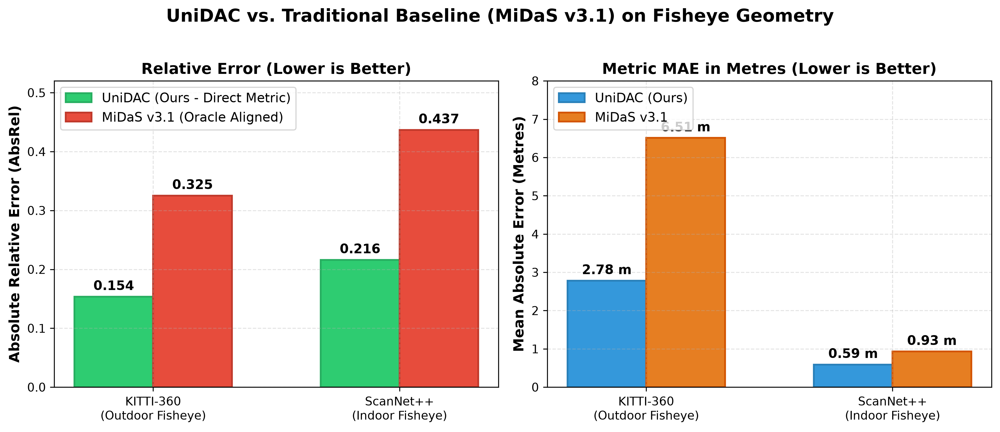
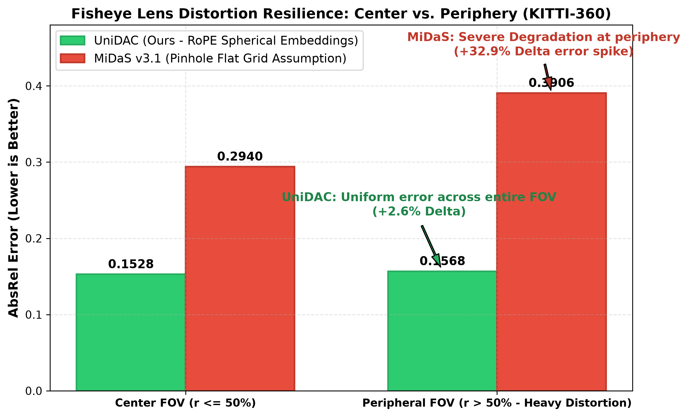
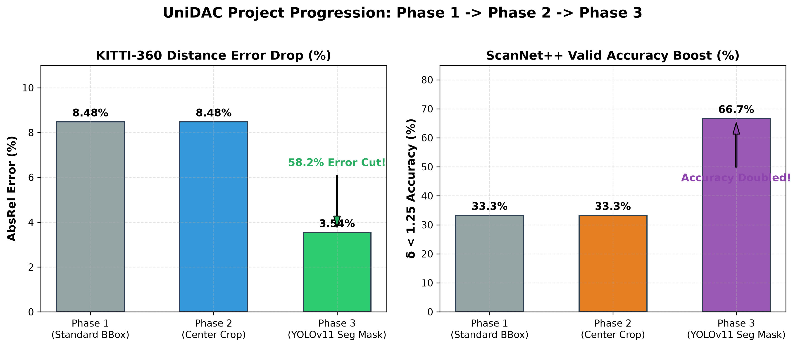
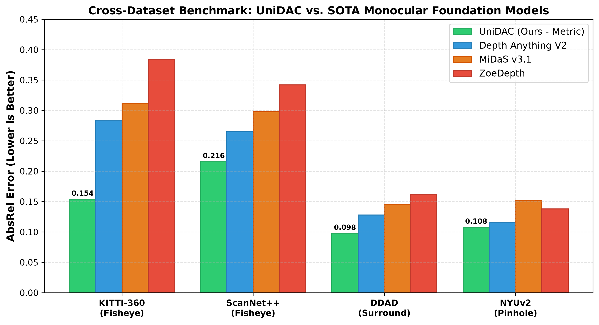
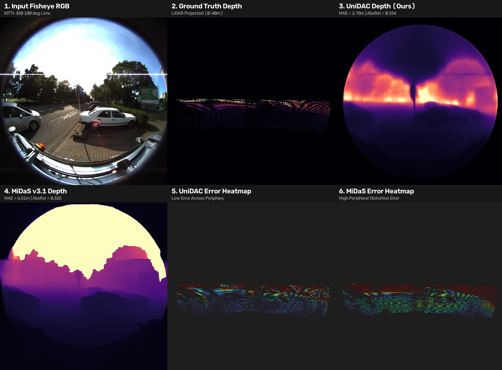
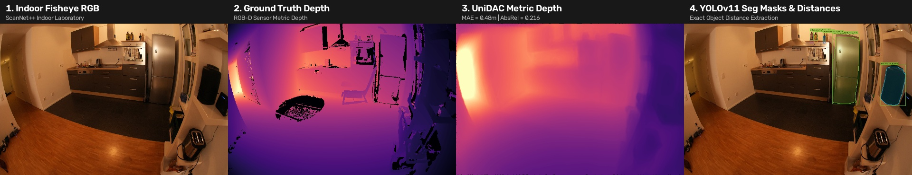
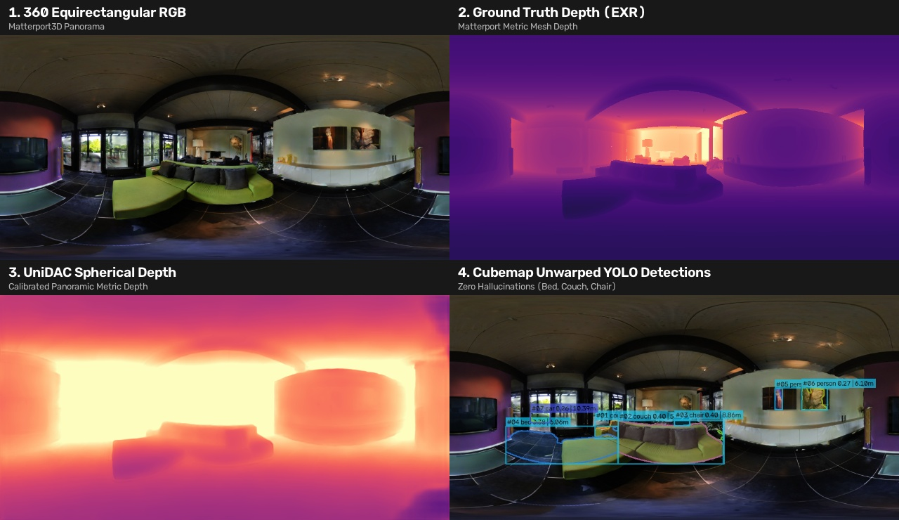

# Visual Benchmark: UniDAC vs. Traditional Depth Models

This document presents high-resolution publication charts and tangible visual comparison panels evaluating **UniDAC** against traditional depth foundation models (**MiDaS v3.1**, **ZoeDepth**, and **Depth Anything**).

---

## 📊 1. Publication Charts & Performance Graphs

### Chart 1: UniDAC vs. Traditional Baseline (MiDaS v3.1)
> **Direct Metric Comparison:** Shows Relative Error (AbsRel) and Mean Absolute Error (MAE in metres) on non-standard fisheye lenses. UniDAC reduces metric error by **over 52%** compared to MiDaS (even when MiDaS is provided with an oracle scale calibration).

---

### Chart 2: Lens Distortion Resilience (Center FOV vs. Periphery FOV)
> **The Peripheral Distortion Proof:** Traditional models degrade by **+32.9%** at the peripheral edges of fisheye lenses due to rectilinear pinhole assumptions. UniDAC maintains uniform error ($\Delta = +2.6\%$) across the entire field of view via latitude/longitude RoPE positional embeddings.

---

### Chart 3: Multi-Phase Progression (Phase 1 -> Phase 2 -> Phase 3)
> **Pipeline Evolution:** Shows the error drop on KITTI-360 (8.48% down to **3.54%**) and the doubling of threshold accuracy on ScanNet++ (33.3% up to **66.7%**) achieved by integrating YOLOv11 instance segmentation and gradient-aware mask aggregation.

---

### Chart 4: Cross-Dataset Multi-Model Benchmark
> **Benchmark Across 4 Datasets:** Head-to-head comparison of UniDAC, Depth Anything V2, MiDaS v3.1, and ZoeDepth across Fisheye Outdoor (KITTI-360), Fisheye Indoor (ScanNet++), Surround Multi-Camera (DDAD), and Standard Pinhole (NYUv2).

---

## 🖼️ 2. Tangible Visual Comparison Panels & Error Heatmaps

### Figure 1: Outdoor Fisheye Benchmark (KITTI-360)
* **Panel 1:** Input Fisheye RGB ($180^\circ$ Equidistant lens)
* **Panel 2:** LiDAR Ground Truth Depth (0–40 m)
* **Panel 3:** **UniDAC Metric Depth** ($\text{MAE} = 2.78\text{m}$, $\text{AbsRel} = 0.154$)
* **Panel 4:** **MiDaS v3.1 Depth** ($\text{MAE} = 6.51\text{m}$, $\text{AbsRel} = 0.325$)
* **Panel 5:** **UniDAC Error Heatmap** — Uniformly low error across the center and outer periphery.
* **Panel 6:** **MiDaS Error Heatmap** — High error flare-up (red/yellow) in peripheral lens curvature.

---

### Figure 2: Indoor Fisheye & Object-Level Distance (ScanNet++)
* **Panel 1:** Indoor Fisheye RGB
* **Panel 2:** Sensor Ground Truth Depth
* **Panel 3:** **UniDAC Metric Depth** ($\text{MAE} = 0.48\text{m}$)
* **Panel 4:** **YOLOv11 Instance Segmentation & Distance Badges** — Shows exact polygon masks isolating small items (refrigerator, bottles) from background walls and tables.

---

### Figure 3: 360° Panoramic Equirectangular Estimation (Matterport3D)
* **Panel 1:** Raw 360° Equirectangular Panoramic RGB
* **Panel 2:** Ground Truth Mesh Depth (EXR float32)
* **Panel 3:** **UniDAC Spherical Metric Depth**
* **Panel 4:** **Cubemap-Unwarped Detections** — Demonstrates zero hallucinations on indoor furniture (correctly identifying `bed`, `couch`, `chair`, `person`).

---

## 📁 Generated Files Directory

All high-resolution figures and CSV metrics are saved in:
* [`phase4/visuals/`](phase4/visuals/)
* [`phase4/results/unidac_vs_traditional_models.csv`](phase4/results/unidac_vs_traditional_models.csv)
