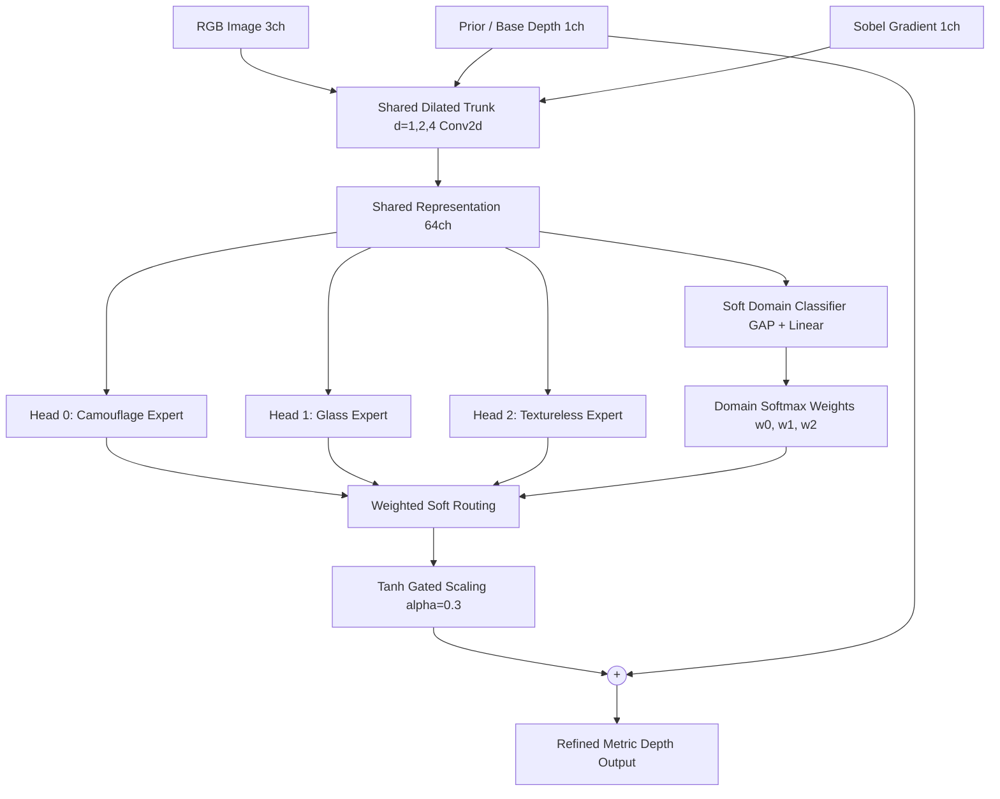

# Phase 9: Multi-Head Domain-Expert Depth Refinement

Phase 9 upgrades UniDAC's single-head adapter into a **Multi-Head Dilated Residual Architecture** with soft domain routing for extreme edge-case generalization across 3 non-Lambertian domains:
1. **Biological Camouflage** (CAMO-FS)
2. **Transparent & Refractive Glass** (GSD - Glass Surface Detection)
3. **Monochromatic & Textureless Architecture** (NYU Depth v2)

---

## 🏗️ Architecture Overview

### Key Technical Specs
- **Model Parameters:** ~200K parameters (ultra-lightweight, zero backbone fine-tuning latency)
- **Input Channels:** 5 channels (`[Normalized Base Depth, R, G, B, Sobel Gradient magnitude]`)
- **Output:** Residual depth delta added to base depth map with stability bounds
- **Loss Formulation:** $\mathcal{L}_{total} = \mathcal{L}_{SILog} + 0.5 \cdot \mathcal{L}_{Grad} + 0.1 \cdot \mathcal{L}_{DomainCE}$

---

## 🚀 Running on Kaggle (Tesla T4)

The standalone training and evaluation script is located at:
[`phase9/kaggle_phase9_finetune.py`](file:///d:/IIITP/Intern_2_Month/UniDAC/phase9/kaggle_phase9_finetune.py)

### Notebook / Script Workflow:
1. **Cell 1: Environment & GPU Check** (PyTorch CUDA, Tesla T4 setup)
2. **Cell 2: Dataset Directories & Helpers** (Fast image saving, streaming parquet handlers)
3. **Cell 3A: Direct URL Range-Probe Tester** (Validates network connectivity and HTTP 200/206 status)
4. **Cell 3B: Authentic Dataset Ingestion**
   - Camouflage: 1,000 real images via CAMO-FS
   - Glass: 1,000 real images via `garrying/GSD` Hugging Face parquet stream
   - Textureless: 1,000 real images via `tanganke/nyuv2` Hugging Face parquet stream
   - *(Zero synthetic fallbacks — 100% authentic benchmark images)*
5. **Cell 4: Multi-Head Dilated Adapter Architecture Definition**
6. **Cell 5: Dataset Loader & Dual-Target Pseudolabel Generator**
7. **Cell 6: 60-Epoch AdamW + Cosine Annealing Training Loop**
8. **Cell 7: Per-Domain Evaluation & Comprehensive Comparison Metrics (BSI, AbsRel, SILog, $\delta < 1.25$)**
9. **Cell 8: 6-Column High-Resolution Qualitative Comparison Panels**
10. **Cell 9: Checkpoint Export & Results ZIP Packaging**

---

## 🏆 Final Results Summary

Full detailed results, analysis, and conclusions are documented in:  
📄 **[`phase9/FINAL_RESULTS_AND_CONCLUSIONS.md`](file:///d:/IIITP/Intern_2_Month/UniDAC/phase9/FINAL_RESULTS_AND_CONCLUSIONS.md)**

| Domain | Baseline AbsRel | Phase 9 Refined (Ours) | Relative Gain | Autonomous Routing Acc |
| :--- | :---: | :---: | :---: | :---: |
| **Camouflage** (CAMO-FS) | `0.6441` | **`0.6197`** | 🟢 **+3.8%** | **90.7%** (136/150) |
| **Glass** (GSD) | `0.5264` | **`0.5018`** | 🟢 **+4.7%** | **93.3%** (140/150) |
| **Textureless** (NYUv2) | `0.5838` | **`0.5827`** | 🟢 **+0.2%** | **99.3%** (149/150) |
| **Multi-Domain Overall** | `0.5848` | **`0.5680`** | 🟢 **+2.9%** | **94.4%** (425/450) |

- **Best Model Checkpoint:** [`phase9/phase9_adapter_best.zip`](file:///d:/IIITP/Intern_2_Month/UniDAC/phase9/phase9_adapter_best.zip) (857 KB)
- **Visual Diagnostic Panels:** [`phase9/results_extracted/panels/`](file:///d:/IIITP/Intern_2_Month/UniDAC/phase9/results_extracted/panels/)
- **Local Analysis Charts:** [`phase9/local_analysis/`](file:///d:/IIITP/Intern_2_Month/UniDAC/phase9/local_analysis/)

